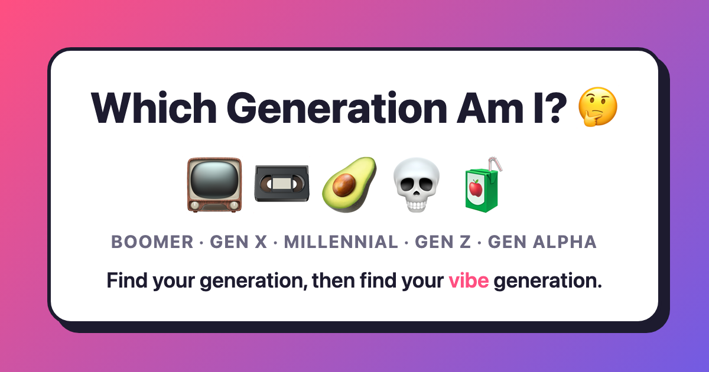

<div align="center">

# 🤔 What Gen Am I?

**Boomer? Millennial? Gen Z? Find out in two seconds - then find out which generation you _actually_ vibe with.**

[**▶ Try it live**](https://expresshermes.github.io/what-gen-am-i/) · [Report a bug](https://github.com/ExpressHermes/what-gen-am-i/issues) · [Suggest a question](https://github.com/ExpressHermes/what-gen-am-i/issues)




</div>

---

## ✨ What it does

1. **🎂 Type your birth year** → get your official generation, the years it spans, and a little roast about it.
2. **🧬 Cusper detection** → born on a boundary? You might be a *Generation Jones*, *Xennial* or *Zillennial*.
3. **🧠 Take the vibe quiz** → 8 BuzzFeed-style questions (*"An unknown number is calling you. You…"*) reveal the generation you **really** belong to.
4. **📣 Share the drama** → *"Born a Millennial 🥑 but I vibe like a Baby Boomer 📺"* — as a shareable image card, or straight to WhatsApp, X or Facebook.

Plus:

- 🌙 **Dark mode** that follows your system and remembers your choice
- 🦕 Born before 1901? You're a **fossil**. Born in the future? You're **not born yet** — but if it's before 2040, we'll tell you you're destined to be **Gen Beta** 🍼.
- 🤷 "I don't…" answers for people who refuse to be categorised
- ♿ Keyboard-friendly, screen-reader-friendly, reduced-motion-friendly

## 🤝 Contributing

PRs welcome! Funny questions, better roasts, accessibility fixes, translations — all good.

1. Fork it and clone your fork:
   ```bash
   git clone https://github.com/<your-username>/what-gen-am-i.git
   cd what-gen-am-i
   ```
2. Create a branch: `git checkout -b my-hilarious-question`
3. Make your change, preview it with `python3 -m http.server 8000` (then open <http://localhost:8000>), and run `node check.js`
4. Open a pull request with your best generational joke in the description

Please keep it fun and kind — we're poking fun at *eras*, not people.

## 📜 License

[MIT](LICENSE) — do whatever you like, just don't call a Gen X-er a Boomer.
